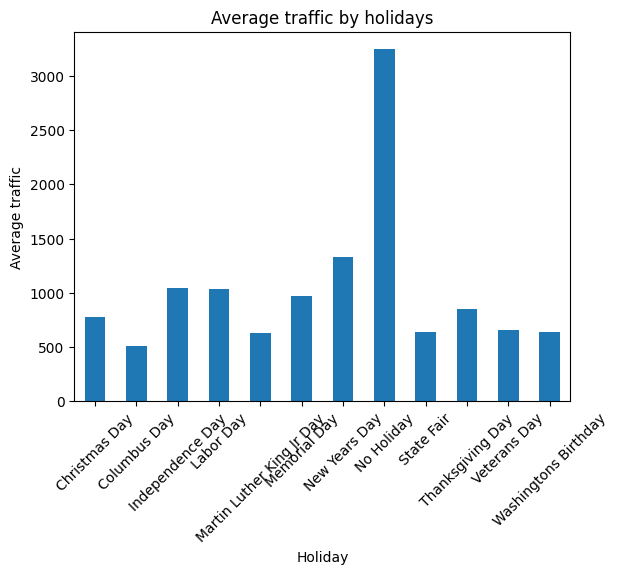
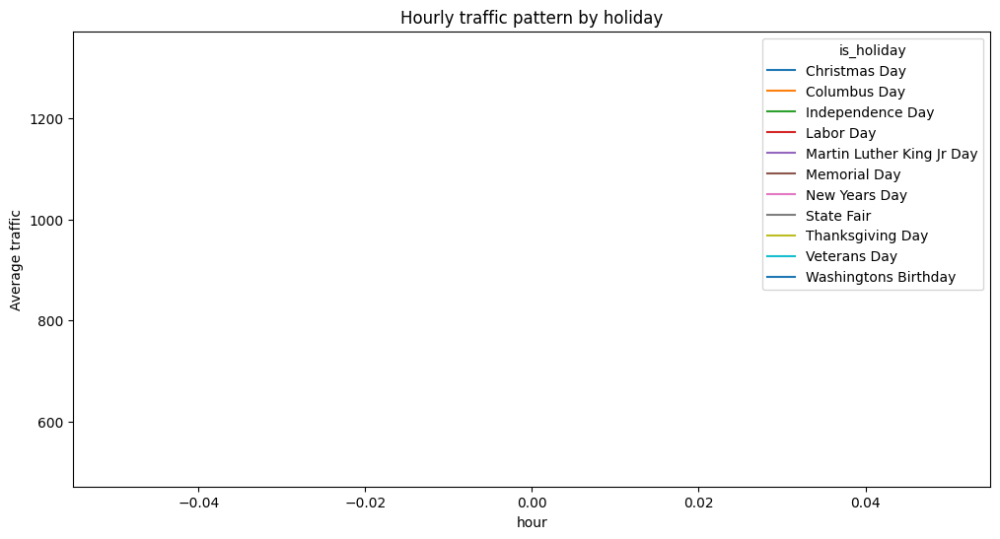
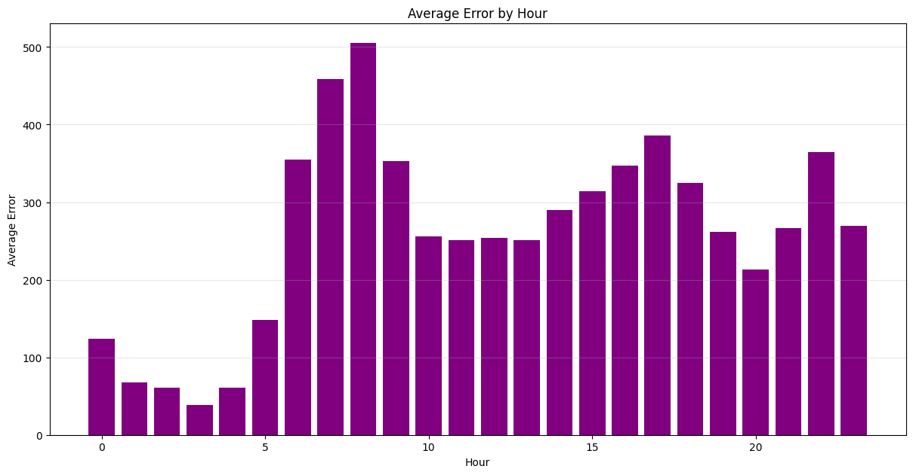
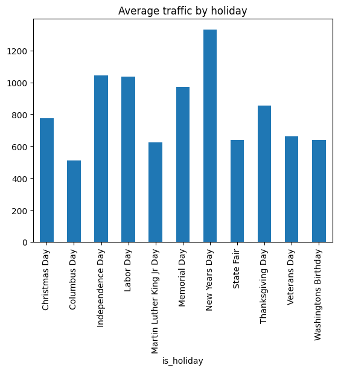
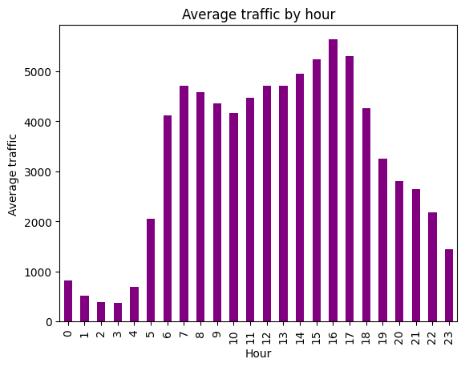
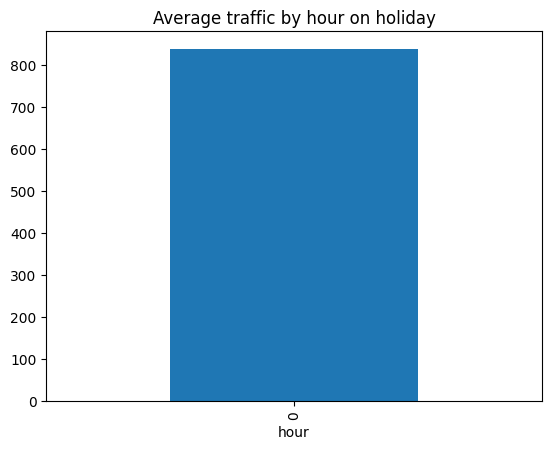
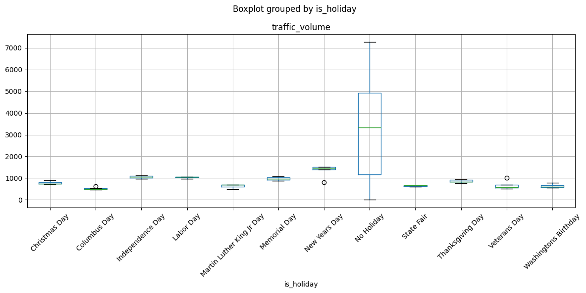
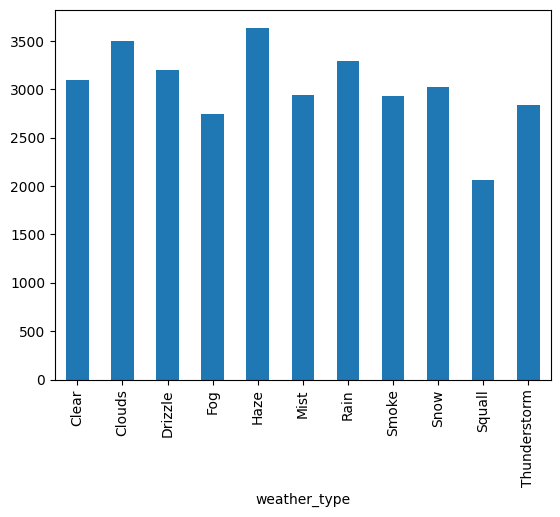

# Traffic Volume Prediction Analysis

## Project Overview
This project focuses on analysing and predicting traffic volume using Python and Machine Learning techniques.

The project includes:
- Data cleaning and preprocessing
- Exploratory Data Analysis (EDA)
- Traffic pattern visualization
- Feature engineering
- Linear Regression model
- Random Forest Regressor model
- Model comparison and error analysis

---

## Technologies Used
- Python
- SQL
- SQLite
- Pandas
- NumPy
- Matplotlib
- Scikit-Learn
- Google Colab
---

## Project Pipeline

1. Traffic Data Collection
2. Data Cleaning & Preprocessing
3. Exploratory Data Analysis (EDA)
4. Feature Engineering
5. Train-Test Split
6. Linear Regression Model Development
7. Random Forest Regression Model Development
8. Model Evaluation and Comparison
9. Traffic Volume Prediction
10. Insight Generation for Transportation Planning

---

## Dataset Features

The dataset contains:
- Traffic volume
- Hour
- Day of week
- Month
- Temperature
- Humidity
- Wind speed
- Air pollution index
- Rain and snow data
- Holiday information

---

## Machine Learning Models Used

### 1. Linear Regression
Used as the baseline prediction model.

### 2. Random Forest Regressor
Used to improve prediction accuracy using ensemble learning.

---

## Model Performance

| Model | Mean Absolute Error |
|------|------|
| Linear Regression | 1607 |
| Random Forest Regressor | 259 |

Random Forest performed significantly better than Linear Regression.

---

## Key Insights
- Traffic volume is strongly dependent on time-based features.
- Hour of the day is the most important feature.
- Weather variables contribute less compared to time variables.
- Rush hour periods are harder to predict accurately.

---
## Business Impact

Accurate traffic forecasting can help:

- Reduce urban congestion
- Improve traffic signal planning
- Support transportation infrastructure decisions
- Optimize public transport deployment
- Improve commuter experience
  ---

## Project Structure

traffic_volume_prediction.ipynb
→ Week 1 ML and Traffic Analysis

traffic_volume_sql_analytics.ipynb
→ Week 4 SQL Integration and Analytics

traffic_analysis_report.pdf
→ Detailed Project Report

traffic_volume_prediction_presentation.pptx
→ Project Presentation

## Visualization Example

## Data Visualizations

### Average Traffic by Holiday

This visualization compares average traffic volume during holiday and non-holiday periods.

---

### Holiday Traffic Pattern

This chart illustrates how traffic behavior changes around holidays.

---

### Prediction Error by Hour

This analysis highlights model prediction errors across different hours of the day.

---

### Average Traffic by Holiday (Alternative Analysis)

Additional comparison of traffic volume patterns during holidays.

---

### Average Traffic by Hour

This visualization identifies peak and off-peak traffic periods throughout the day.

---

### Average Traffic by Hour on Holidays

This chart shows hourly traffic variations specifically during holiday periods.

---

### Holiday Traffic Distribution

Box plot analysis showing traffic volume distribution during holiday and non-holiday periods.

---

### Traffic Pattern by Holiday

Visualization of traffic trends and seasonal holiday effects.

---

### Traffic Volume by Weather Conditions

Analysis of how different weather conditions affect traffic volume.
---

## Project Evolution

### Phase 1: Traffic Volume Prediction (Week 1)

Notebook:
traffic_volume_prediction.ipynb

Covered:

- Data Cleaning and Preprocessing
- Exploratory Data Analysis (EDA)
- Feature Engineering
- Linear Regression
- Random Forest Regression
- Model Evaluation
- Traffic Pattern Analysis
- Business Insights

### Phase 2: SQL Analytics Integration (Week 4)

Notebook:
traffic_volume_sql_analytics.ipynb

Objective:

To simulate a real-world analytics workflow by integrating SQL with the existing traffic prediction project.

Key Activities:

- Created SQLite database from traffic dataset
- Stored data using Pandas to_sql()
- Queried data using read_sql_query()
- Performed SQL aggregations
- Combined SQL with Pandas for analysis
- Generated business insights from SQL queries

SQL Concepts Demonstrated:

- SELECT
- WHERE
- GROUP BY
- ORDER BY
- AVG()
- COUNT()
- LIMIT

Business Insights Generated:

- Peak traffic occurs at 4 PM (Hour 16)
- Weekday traffic is higher than weekend traffic
- Thursday and Friday are the busiest days
- Traffic volume decreases significantly on holidays
- Traffic patterns are primarily time-driven

Analytics Pipeline:

Traffic CSV
↓
SQLite Database
↓
SQL Queries
↓
Pandas Analysis
↓
Visualization
↓
Machine Learning
↓
Business Insights

## Future Improvements
• Add lag and rolling-window features
• Compare with XGBoost and LightGBM
• Develop Streamlit dashboard
• Real-time traffic forecasting
• Generate congestion mitigation recommendations

---

## Author
Abhishek Kumar
IIT Kharagpur
